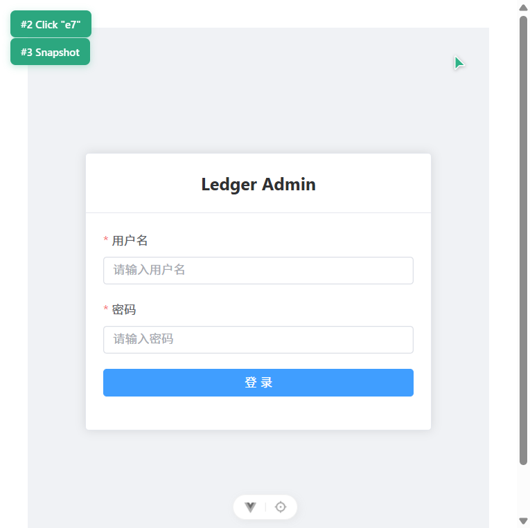
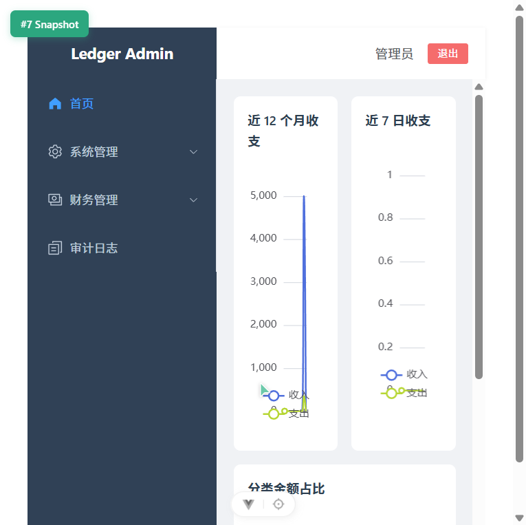
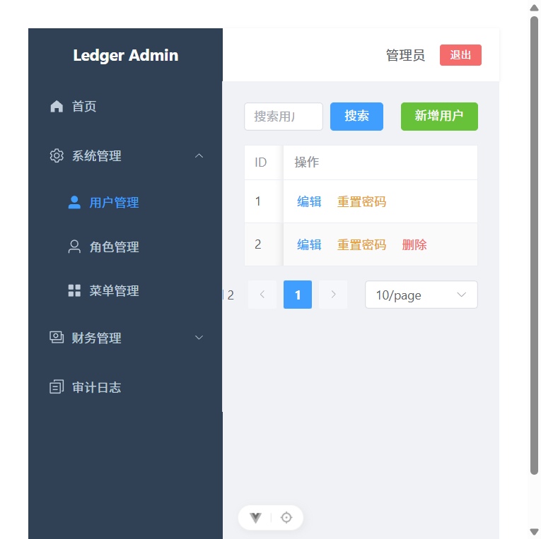
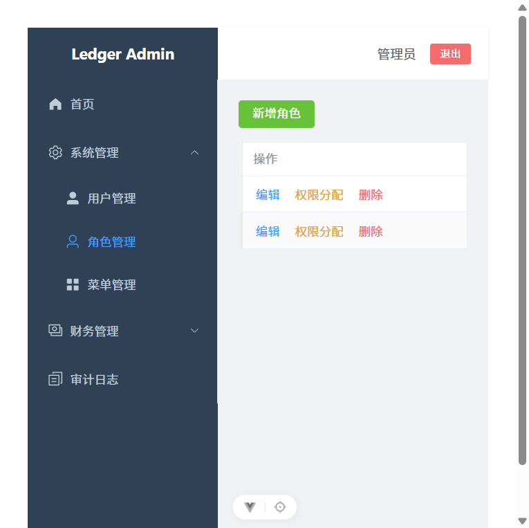
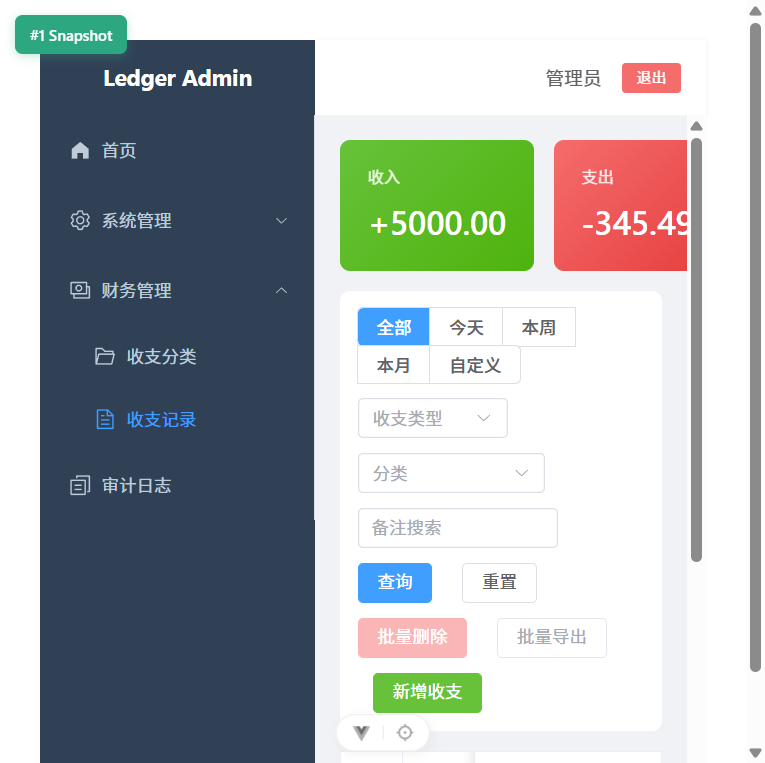
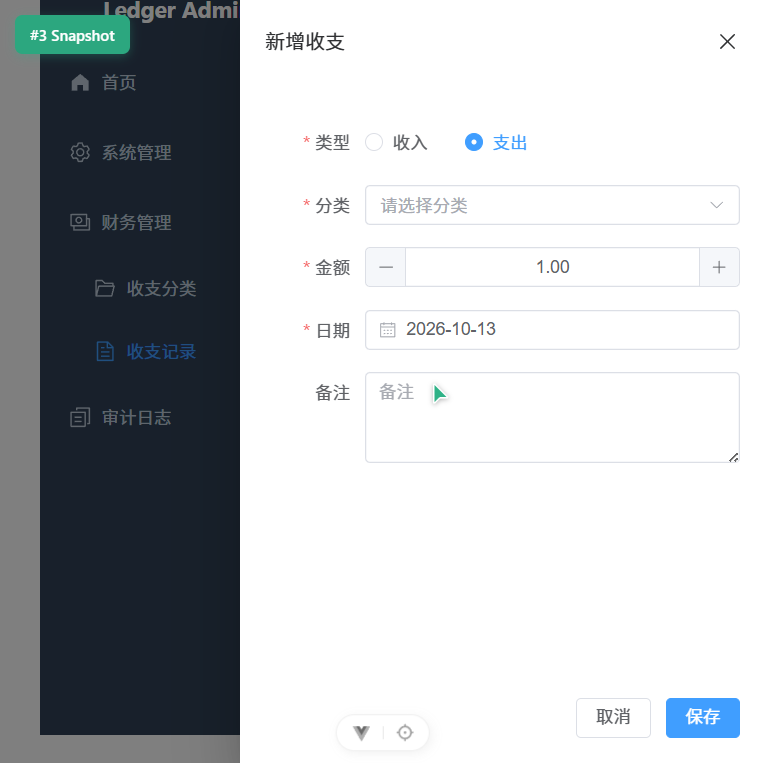
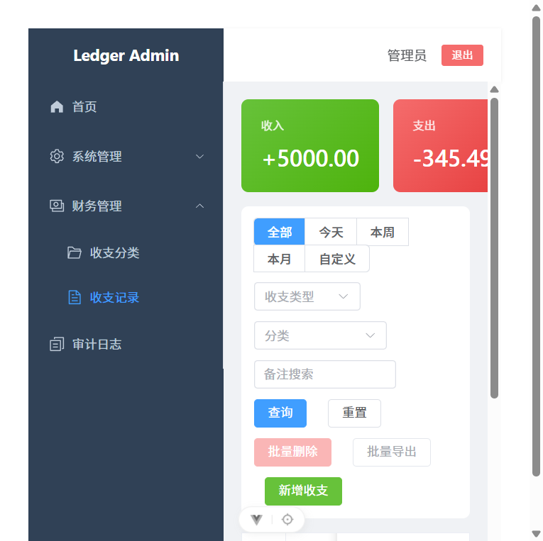
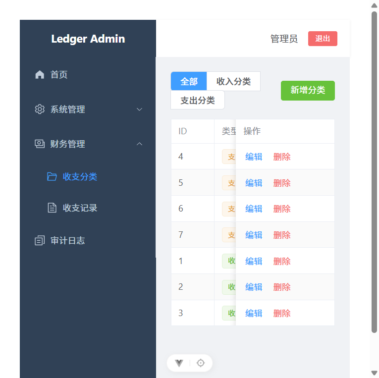
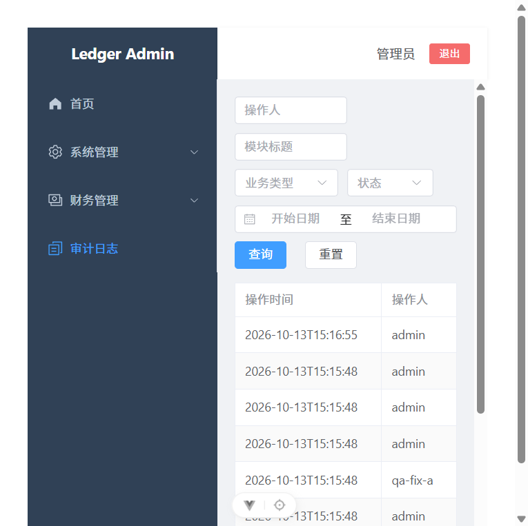

# 账务权限管理系统 · 工程介绍

> 实习生 AI Coding 全栈开发实战考核交付物。系统由"后台权限管理"与"财务收支记账"两部分组成，
> 前后端分离，代码 80% 以上由 AI 辅助生成，开发过程以 OpenSpec 规范文档作为唯一事实来源。

## 一、项目概述

系统面向两类使用者：

- **管理员**：维护用户、角色、菜单，配置角色可访问的菜单与按钮权限，可查看全部用户的收支数据与操作日志。
- **普通用户**：维护自己的收支分类与收支记录，按时间/类型/分类/备注多条件筛选，查看统计与图表，导出自己的数据。

功能覆盖考核的 80 分基础项与 20 分加分项全部内容：

| 分类 | 功能 |
|---|---|
| 基础必做 | 账号密码登录、JWT 鉴权、用户管理、角色管理、菜单管理、收支分类管理、收支记录管理、多条件筛选、金额统计 |
| 可选加分 | 数据可视化看板（4.1）、Excel 导出（4.2）、批量操作（4.3）、按钮级权限（4.4）、软删除与操作日志（4.5） |

## 二、技术选型

### 后端

| 技术 | 版本 | 说明 |
|---|---|---|
| Spring Boot | 3.5.0 | 父工程与依赖管理 |
| JDK | 25（运行时） / release 21 | 本机全局 java 为 8，构建须显式指定 JDK 25 |
| MyBatis-Plus | 3.5.12 | `mybatis-plus-spring-boot3-starter` + `mybatis-plus-jsqlparser` |
| MySQL | 8.0.34 | 库名 `ledger`，字符集 utf8mb4 |
| Spring Security | 随 Boot | 无状态会话 + 方法级 `@PreAuthorize` |
| jjwt | 0.12.6 | HS256 签发与校验 |
| EasyExcel | 4.0.3 | 收支记录导出 |
| Maven | 3.x（`D:\maven`） | 构建工具 |

### 前端

| 技术 | 版本 | 说明 |
|---|---|---|
| Vue | 3.5 | Composition API + `<script setup>` |
| Vite | 8.x | 开发服务器与构建 |
| TypeScript | 6.0 | 全量类型标注 |
| Element Plus | 2.14 | UI 组件库 |
| Pinia | 4.x | 状态管理（user / permission） |
| Vue Router | 5.x | 静态路由注册 + 全局守卫 |
| Axios | 1.x | 统一封装拦截器 |
| ECharts | 6.x | 看板图表 |

## 三、系统架构

### 整体结构

```
浏览器 (Vue3 SPA)
   │  Axios 注入 Authorization: Bearer <token>
   ▼
Vite dev server :5173  ──/api/* 代理──▶  Spring Boot :8081
                                            │
              ┌─────────────────────────────┼──────────────────────────┐
              ▼                             ▼                          ▼
      Security 过滤器链              Controller → Service          MyBatis-Plus
      (JwtAuthenticationFilter)              │                          │
              │                              ▼                          ▼
      @PreAuthorize 方法鉴权          AOP 操作日志切面              MySQL 8 (ledger)
```

### 后端分包职责

| 包 | 职责 | 代表类 |
|---|---|---|
| `config` | 安全配置、MyBatis-Plus、跨域、启动初始化 | `SecurityConfig`、`MyBatisPlusConfig`、`InitDataRunner` |
| `security` | JWT 工具、认证过滤器、登录用户、权限判定 | `JwtTokenUtil`、`JwtAuthenticationFilter`、`PermissionService`（Bean 名 `ss`） |
| `controller` | 接口入口，声明路径与所需权限 | `AuthController`、`UserController`、`RecordController`、`ExportController` |
| `service` | 业务逻辑、数据隔离、事务 | `RecordService`、`UserService`、`RoleService`、`AuthService` |
| `mapper` | 数据访问，复杂统计用注解 SQL | `FinRecordMapper`（月/日/分类聚合） |
| `entity` | 数据库实体，`@TableLogic` 标记逻辑删除 | `SysUser`、`FinRecord`、`SysMenu` |
| `dto` | 请求与导出模型 | `RecordQueryDTO`、`RecordExportDTO`、`RecordExcelVO` |
| `common` | 统一返回、分页、异常处理 | `Result`、`PageResult`、`GlobalExceptionHandler` |
| `annotation` / `aspect` | 操作日志注解与切面 | `@OperLog`、`OperLogAspect` |

### 前端目录职责

| 目录 | 职责 |
|---|---|
| `api/` | 按模块封装接口，统一从 `utils/request.ts` 发起 |
| `stores/` | `user.ts` 保存 token/用户信息/菜单/perms，`permission.ts` 提供 `hasPerm` |
| `router/` | 静态注册全部页面路由，元信息 `meta.perm` 声明所需权限 |
| `layouts/` | `Layout.vue` 主框架，`SubMenu.vue` 递归渲染侧边栏 |
| `views/` | 登录、看板、用户/角色/菜单、分类/记录、操作日志 |
| `directives/` | `v-permission` 指令（已注册，实际统一使用 `hasPerm`） |

## 四、数据库设计

库名 `ledger`，8 张表，初始化脚本见 `backend/src/main/resources/sql/schema.sql` 与 `data.sql`。

### 权限相关（5 张）

| 表 | 关键字段 | 说明 |
|---|---|---|
| `sys_user` | `username`(唯一)、`password`(BCrypt)、`status`、`is_deleted` | 用户 |
| `sys_role` | `role_code`(唯一，`admin` 为管理员标识)、`status` | 角色 |
| `sys_menu` | `parent_id`、`menu_type`(1目录/2菜单/3按钮)、`path`、`perms`、`sort_order` | 菜单与按钮权限 |
| `sys_user_role` | `user_id`、`role_id`（联合唯一） | 用户-角色 |
| `sys_role_menu` | `role_id`、`menu_id`（联合唯一） | 角色-菜单 |

### 业务与审计（3 张）

| 表 | 关键字段 | 说明 |
|---|---|---|
| `fin_category` | `type`(income/expense)、`name`、`is_deleted` | 收支分类 |
| `fin_record` | `user_id`、`type`、`category_id`、`amount DECIMAL(12,2)`、`record_date`、`is_deleted` | 收支记录，`idx_user_date` 联合索引 |
| `sys_oper_log` | `username`、`title`、`business_type`、`request_params`、`status`、`cost_time` | 操作日志 |

### 设计要点

1. **金额精度**：`DECIMAL(12,2)` + Java `BigDecimal`，全链路不出现 `double`，统计用 `SUM(amount)`。
2. **逻辑删除**：业务表均有 `is_deleted`，MyBatis-Plus 全局配置 `logic-delete-field: isDeleted`，查询自动追加 `is_deleted = 0`。
3. **权限标识**：按钮权限存于 `sys_menu.perms`（如 `finance:record:export`），与后端 `@PreAuthorize` 注解值、前端 `hasPerm` 入参三者一致。

## 五、权限体系说明

### 认证流程

1. `POST /api/auth/login` → `AuthService` 交给 `AuthenticationManager` 校验 → `UserDetailsServiceImpl` 加载用户与权限 → BCrypt 比对密码。
2. 校验通过后 `JwtTokenUtil` 签发 HS256 令牌（payload：`userId`、`username`，有效期 2 小时）。
3. 后续请求由 `JwtAuthenticationFilter` 解析令牌并注入 `LoginUser` 到 SecurityContext。
4. 未携带或令牌失效 → `JwtAuthenticationEntryPoint` 返回 401；已认证但无权限 → `JwtAccessDeniedHandler` 或 `GlobalExceptionHandler` 返回 403。

### 授权模型

- **菜单级**：登录后 `GET /api/auth/info` 返回当前用户的菜单树，前端侧边栏据此渲染。
- **路由级**：前端静态注册路由，`meta.perm` 与用户 perms 比对，不匹配则跳转到用户可访问的首个菜单。
- **按钮级**：前端 `hasPerm('finance:record:add')` 控制按钮显隐；后端 `@PreAuthorize("@ss.hasPermi('finance:record:add')")` 二次校验，绕过前端直接调接口会 403。

### 数据隔离

`RecordService.isolationWrapper()` 统一处理：普通用户查询强制追加 `user_id = 当前用户`；角色编码为 `admin` 的用户返回 `*:*:*` 通配权限，可查看全部数据。列表、统计、导出、看板四个入口共用同一隔离规则。

## 六、目录结构

```
work-2/
├── backend/
│   ├── pom.xml
│   └── src/main/
│       ├── java/com/ledger/
│       │   ├── annotation/  aspect/  common/  config/
│       │   ├── controller/  dto/  entity/  mapper/
│       │   ├── security/  service/  LedgerApplication.java
│       └── resources/
│           ├── application.yml
│           ├── mapper/SysMenuMapper.xml
│           └── sql/{schema.sql, data.sql}
├── frontend/
│   ├── vite.config.ts          # /api 代理到 8081
│   ├── index.html
│   └── src/
│       ├── api/  assets/  directives/  layouts/  router/
│       ├── stores/  utils/  views/  App.vue  main.ts
├── docs/                       # 工程介绍、测试报告、提示词记录、演示脚本、截图
└── openspec/                   # 规范驱动开发文档（proposal/design/tasks/specs）
```

## 七、环境准备与启动

### 1. 环境要求

| 项 | 要求 | 本机实测 |
|---|---|---|
| JDK | 21+（编译目标 21），本项目用 JDK 25 | `C:\Program Files\Java\jdk-25` |
| Maven | 3.6+ | `D:\maven` |
| Node | ^22.18 或 >=24.12 | Node 24 / npm 11 |
| MySQL | 8.0 | 本机服务 `MySQL80` 运行中 |

> 注意：本机全局 `java` 指向 Java 8。构建时必须显式设置 `JAVA_HOME`，或让 Maven 使用 JDK 25，否则会因版本不匹配失败。

### 2. 初始化数据库

按顺序执行两个脚本（第二个脚本会写入角色、菜单、角色菜单关联与示例分类）：

```powershell
mysql -u root -p < backend/src/main/resources/sql/schema.sql
mysql -u root -p < backend/src/main/resources/sql/data.sql
```

`schema.sql` 含 `DROP TABLE IF EXISTS`，重复执行会清空数据。

两个默认账号不用 SQL 写入，而是由 `InitDataRunner` 在后端首次启动时用 BCrypt 现场生成：

| 账号 | 密码 | 角色 | 权限范围 |
|---|---|---|---|
| `admin` | `admin123` | `admin` | 全部菜单与按钮 |
| `user` | `user123` | `user` | 仅财务管理 + 首页 |

### 3. 修改数据库连接

编辑 `backend/src/main/resources/application.yml`：

```yaml
spring:
  datasource:
    url: jdbc:mysql://127.0.0.1:3306/ledger?useUnicode=true&serverTimezone=Asia/Shanghai&useSSL=false
    username: root
    password: <你的密码>
```

`jwt.secret` 为 Base64 编码的 HS256 密钥，`jwt.expiration` 单位毫秒（默认 7200000 = 2 小时）。

### 4. 启动后端

```powershell
$env:JAVA_HOME='C:\Program Files\Java\jdk-25'
cd backend
D:\maven\bin\mvn.cmd spring-boot:run
```

启动成功后监听 `http://localhost:8081`。首次启动日志会输出「初始化默认账号完成」。

也可在 IDEA 中直接运行 `LedgerApplication`，注意把 Project SDK 与 Runner 的 JRE 都设为 JDK 25。

### 5. 启动前端

```powershell
cd frontend
npm install
npm run dev
```

访问 `http://localhost:5173`。`vite.config.ts` 已配置 `/api` 代理到 `http://localhost:8081`，前端无需处理跨域。

其他脚本：`npm run type-check`（vue-tsc 类型检查）、`npm run build`（类型检查 + 生产构建）、`npm run lint`。

## 八、接口清单

所有接口统一前缀 `/api`，除登录外均需携带 `Authorization: Bearer <token>`。

### 认证

| 方法 | 路径 | 权限 | 说明 |
|---|---|---|---|
| POST | `/api/auth/login` | 放行 | 登录，返回 token 与用户信息 |
| GET | `/api/auth/info` | 登录即可 | 当前用户信息、菜单树、perms 列表 |

### 系统管理

| 方法 | 路径 | 权限 |
|---|---|---|
| GET | `/api/system/users` | `system:user:view` |
| POST | `/api/system/users` | `system:user:add` |
| PUT | `/api/system/users/{id}` | `system:user:edit` |
| PUT | `/api/system/users/{id}/status` | `system:user:edit` |
| PUT | `/api/system/users/{id}/reset-password` | `system:user:reset` |
| DELETE | `/api/system/users/{id}` | `system:user:delete` |
| GET | `/api/system/roles` | `system:role:view` |
| GET | `/api/system/roles/{id}/menus` | `system:role:view` |
| POST/PUT/DELETE | `/api/system/roles`、`/{id}` | `system:role:add/edit/delete` |
| GET | `/api/system/menus`、`/tree` | `system:menu:view` |
| POST/PUT/DELETE | `/api/system/menus`、`/{id}` | `system:menu:add/edit/delete` |

### 财务

| 方法 | 路径 | 权限 |
|---|---|---|
| GET | `/api/finance/categories?type=` | `finance:category:view` |
| POST/PUT/DELETE | `/api/finance/categories`、`/{id}` | `finance:category:add/edit/delete` |
| GET | `/api/finance/records` | `finance:record:view` |
| GET | `/api/finance/records/statistics` | `finance:record:view` |
| POST/PUT/DELETE | `/api/finance/records`、`/{id}` | `finance:record:add/edit/delete` |
| DELETE | `/api/finance/records/batch` | `finance:record:delete` |

### 看板 / 导出 / 审计

| 方法 | 路径 | 权限 | 说明 |
|---|---|---|---|
| GET | `/api/dashboard/stats` | `dashboard:view` | 近 12 月、近 7 日、分类占比 |
| POST | `/api/export/records` | `finance:record:export` | 支持 `ids` / `exportAll` / 筛选三态 |
| GET | `/api/audit/logs` | `audit:log:view` | 操作日志分页查询 |

### 统一响应格式

```json
{ "code": 200, "message": "success", "data": {} }
```

分页数据为 `{ "total": 0, "rows": [] }`。鉴权与业务异常时 HTTP 状态码与 `code` 保持一致：401 未认证、403 无权限、400 参数或业务校验失败、500 系统异常。

## 九、界面预览

| 登录页 | 数据看板 |
|---|---|
|  |  |

| 用户管理 | 角色管理 |
|---|---|
|  |  |

| 收支记录 | 新增收支 |
|---|---|
|  |  |

| 批量操作栏 | 收支分类 |
|---|---|
|  |  |

| 操作日志 |
|---|
|  |

## 十、开发过程说明

项目按 OpenSpec 规范推进，`openspec/changes/ledger-admin-system/` 下包含提案、设计、任务清单与 6 份能力 spec（auth / rbac / finance / dashboard / data-export / audit）。实施顺序为：工程骨架与数据库 → 认证 → RBAC → 财务 → 加分项 → 验收文档。

关键 Prompt 记录见 [prompts.md](prompts.md)，验收测试结果见 [test-report.md](test-report.md)，答辩流程见 [presentation.md](presentation.md)。

## 十一、已知限制

1. **看板无筛选控件**：`/api/dashboard/stats` 不含筛选入参，dashboard spec 中「切换统计范围或收支类型」场景未实现。
2. **无自动化测试**：验收全部通过手工接口调用与页面操作完成，`backend/src/test` 未建立。
3. **未引入缓存**：按设计约束不使用 Redis，权限每次请求从数据库加载。
4. **未部署上线**：仅本地运行，无容器化与 CI 配置。
