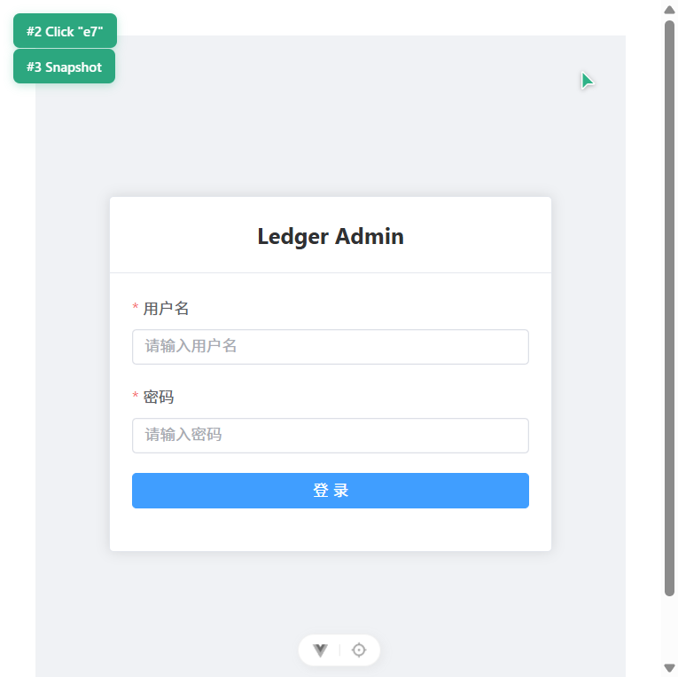
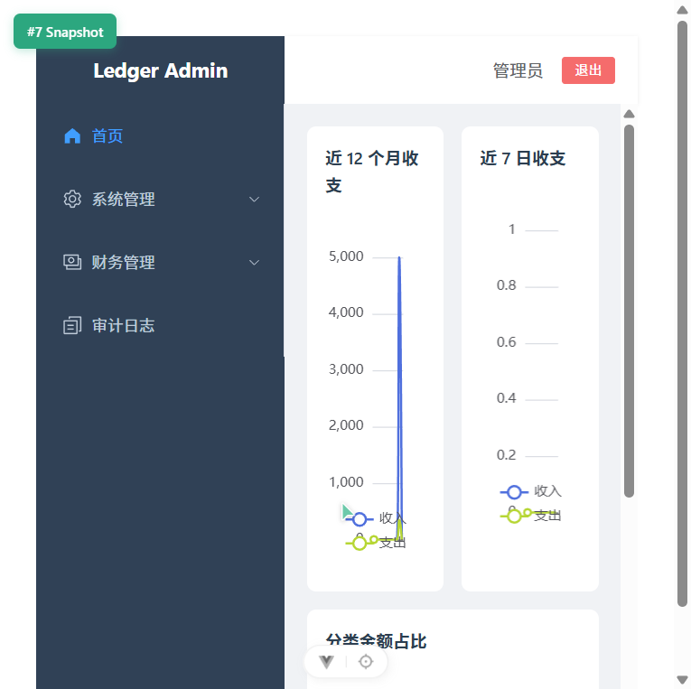
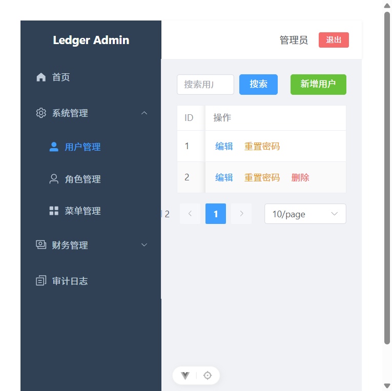
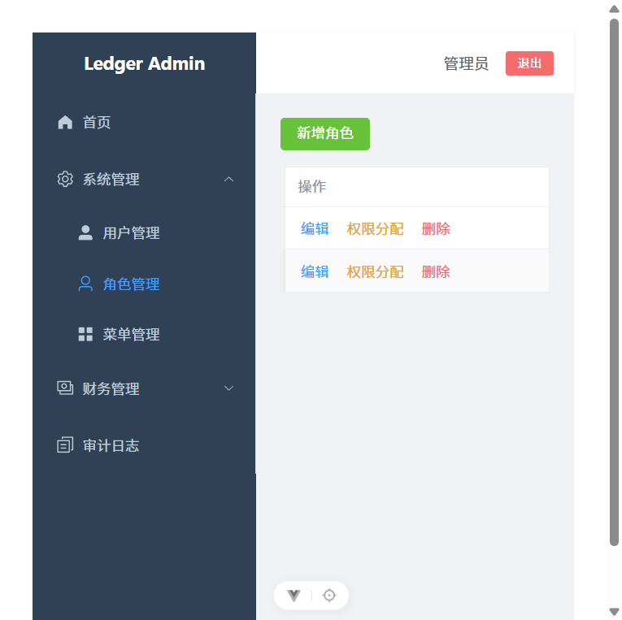
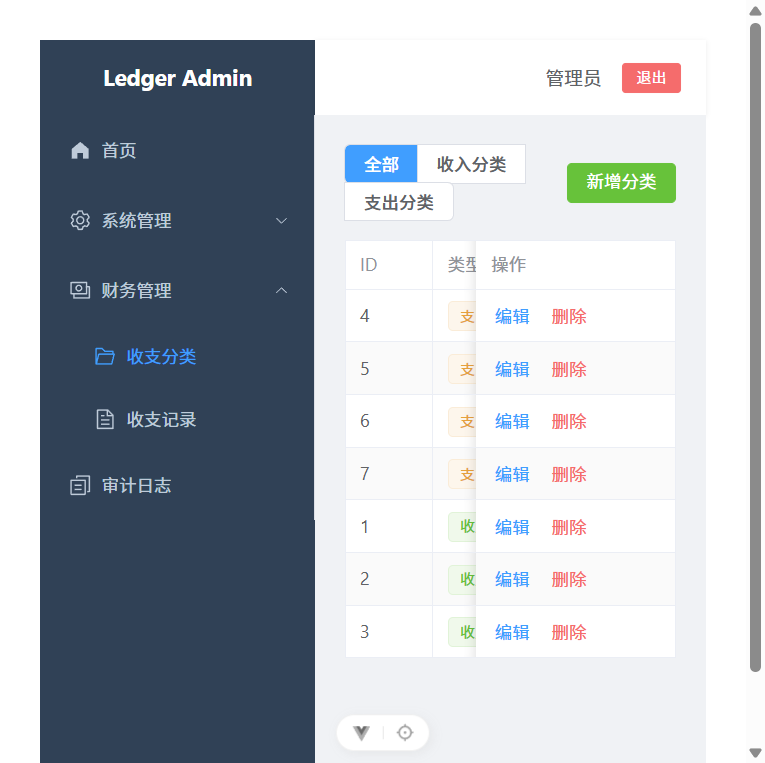
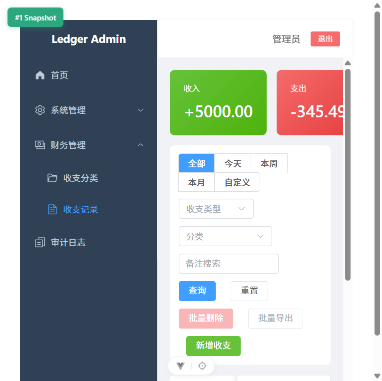
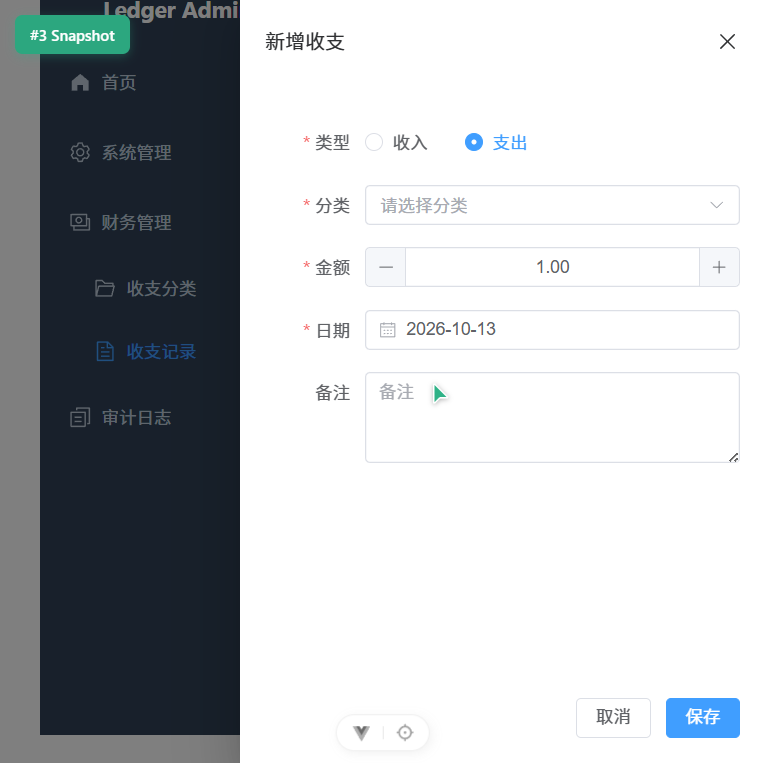
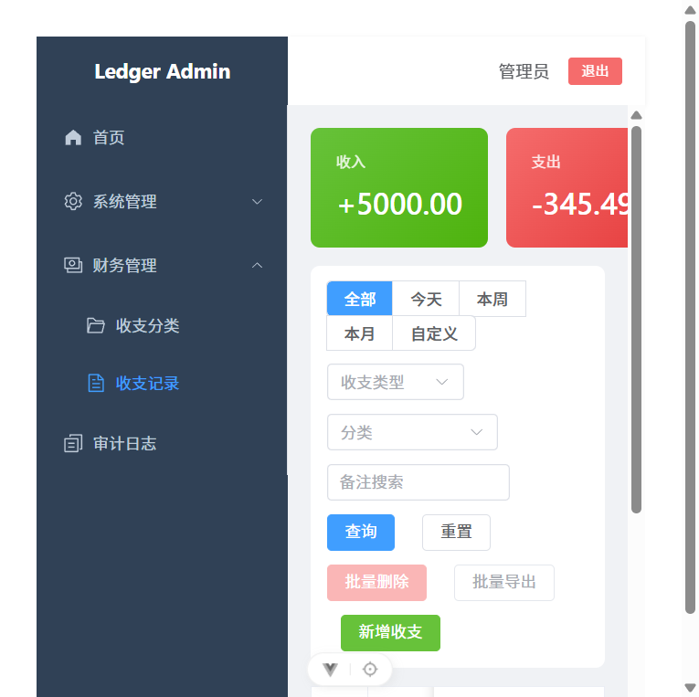
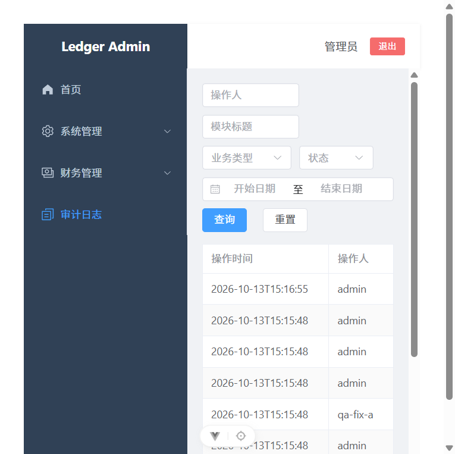

# 验收测试报告

> 测试对象：账务权限管理系统（`ledger-admin-system`）
> 测试依据：`openspec/changes/ledger-admin-system/specs/` 下 6 份能力 spec 的 scenario
> 测试日期：2026-11-10

## 一、测试环境

| 项 | 值 |
|---|---|
| 后端 | Spring Boot 3.5.0，JDK 25（`C:\Program Files\Java\jdk-25`），`http://localhost:8081` |
| 前端 | Vite 8 + Vue 3.5，`http://localhost:5173`（`/api` 代理到 8081） |
| 数据库 | MySQL 8.0.34，库名 `ledger`，utf8mb4 |
| 浏览器 | Chrome（1440 × 900） |
| 构建 | `D:\maven\bin\mvn.cmd compile`、`npm run type-check`、`npm run build-only` 均通过 |

## 二、测试方法

分三层执行：

1. **接口层（主）**：用脚本对 44 个断言逐条调用真实接口，记录 HTTP 状态码与响应内容作为证据。脚本覆盖 6 份 spec 的全部 scenario，额外包含环境与权限边界用例。
2. **页面层**：启动前后端后在浏览器中人工走查关键路径（登录 → 看板 → 各管理页 → 批量操作），确认按钮显隐、分页、图表渲染与截图一致。
3. **静态层**：`mvn compile` 验证后端可编译；`vue-tsc` 验证前端类型；`vite build` 验证无失效引用。

测试数据说明：脚本使用的临时账号（`qa<时间戳>`）、临时角色（`qa_role_*`）、临时分类（`验收分类*`）在用例结束后自动删除；验证软删除的记录保留 `is_deleted=1` 标记，属预期行为。

## 三、测试结果汇总

| 结果 | 数量 |
|---|---|
| 通过 | 44 |
| 未通过 | 0 |
| 合计 | 44 |

> 说明：`D5`（看板按分类/类型筛选刷新）初测时为已知缺口，本轮已实现看板筛选联动并复测通过，全部用例闭合。

## 四、逐条用例结果

### 4.1 环境

| 编号 | 用例 | 结果 | 证据 |
|---|---|---|---|
| ENV | 管理员账号可登录 | 通过 | `admin/admin123` 登录成功，获得 JWT |

### 4.2 auth（认证）

| 编号 | 用例 | 结果 | 证据 |
|---|---|---|---|
| A1 | 正确凭据登录成功 | 通过 | HTTP 200，返回 token 与 `user.username=admin` |
| A2 | 错误凭据登录失败 | 通过 | HTTP 401，提示「用户名或密码错误」，未签发 token |
| A3 | 账号被禁用无法登录 | 通过 | 禁用后登录 HTTP 400，提示「账号已被禁用，无法登录」 |
| A4 | 有效令牌访问受保护接口 | 通过 | `GET /auth/info` HTTP 200，返回 user、perms 9 项、menus 1 组 |
| A5 | 缺失令牌访问受保护接口 | 通过 | 无 token 访问 `/system/users` 返回 HTTP 401 |
| A6 | 被篡改令牌被拒绝 | 通过 | 篡改签名后访问 `/auth/info` 返回 HTTP 401 |
| A7 | 响应不泄露密码字段 | 通过 | 用户列表 3 条记录均无 `password` 字段 |

前端路由守卫部分（未登录跳登录页、已登录访问 `/login` 跳首页）在页面层验证：清除 localStorage 后访问 `/dashboard` 被重定向到 `/login`；已登录状态访问 `/login` 自动跳到 `/dashboard`。

### 4.3 rbac（权限管理）

| 编号 | 用例 | 结果 | 证据 |
|---|---|---|---|
| R1 | 分页搜索用户列表 | 通过 | `keyword=admin` 返回 total=1，首条 username=admin |
| R2 | 新增用户并分配角色 | 通过 | 新增时传 `roleId=2`，该账号可用初始密码登录成功，用户-角色关联生效 |
| R3 | 启用与禁用用户 | 通过 | 禁用后列表 `status=0` 且登录被拒；恢复启用后可正常登录 |
| R4 | 重置密码 | 通过 | 返回 8 位随机新密码，用新密码登录成功（非固定 123456） |
| R5 | 角色 CRUD | 通过 | 新增角色 id=8，编辑后 roleName 变为「验收角色改名」 |
| R6 | 角色分配菜单权限 | 通过 | 保存 `menuIds=[1,50,51,61]` 后查询返回 4 条关联 |
| R7 | 菜单树形展示与 CRUD | 通过 | `/system/menus/tree` 返回 4 个根节点：首页、系统管理、财务管理、审计日志 |
| R8 | 删除含子节点菜单被拒绝 | 通过 | 删除「系统管理」返回 HTTP 400，提示「存在子菜单，不能删除」 |
| R9 | 越权访问被拒绝 | 通过 | 普通用户访问 `/system/users` 返回 HTTP 403，`data=null` |
| R10 | 按权限渲染菜单（接口层） | 通过 | 普通用户菜单 1 组（财务管理），管理员 4 组（含系统管理） |
| R11 | 按钮级权限拦截（后端） | 通过 | 普通用户直接调系统管理接口返回 403；前端按 perms 控制按钮显隐 |

补充说明：`R5` 同时验证了一个已修复的缺陷 —— 此前编辑角色基本信息会回传空 `menuIds`，导致该角色的菜单权限被清空；修复后基本信息保存不再提交 `menuIds`，编辑前后关联数量保持 `11 → 11`。

### 4.4 finance（财务）

| 编号 | 用例 | 结果 | 证据 |
|---|---|---|---|
| F1 | 分类 CRUD | 通过 | 新增分类 id=11，编辑后名称变为「验收分类715-改」 |
| F2 | 删除被记录引用的分类被拒绝 | 通过 | HTTP 400，提示「该分类已被收支记录引用，无法删除」 |
| F3 | 新增记录自动关联当前用户 | 通过 | 普通用户新增记录 id=51，`user_id` 自动写为当前用户 18 |
| F4 | 必填项缺失校验 | 通过 | 缺 categoryId/amount/recordDate 返回 HTTP 400，提示「categoryId:所属分类不能为空」 |
| F5 | 编辑记录 | 通过 | 编辑后金额由 12.34 变为 99.99 |
| F6 | 时间与类型组合筛选 | 通过 | `dateType=month&type=expense` 返回结果全部为 expense |
| F7 | 分类筛选与备注关键词搜索 | 通过 | `categoryId=11&remark=引用` 返回 1 条且分类匹配 |
| F8 | 自定义时间区间筛选 | 通过 | 2026-10-11 ~ 2026-11-10 返回 1 条，区间外 0 条 |
| F9 | 统计随筛选联动 | 通过 | 全部：收入 5077.77 / 支出 445.48 / 结余 4632.29；仅支出：收入 0；仅收入：支出 0 |
| F10 | 金额精度精确到分 | 通过 | 99.99 保存后读取仍为 99.99；结余 4632.29 = 5077.77 − 445.48，无浮点误差 |
| F11 | 用户仅见本人记录 | 通过 | 普通用户列表仅含 `userId=18`，管理员可见 6 条（含他人数据） |

F10 说明：首次脚本断言使用 JavaScript 浮点相减比较（`5077.77 - 445.48`）导致误判，改用 2 位小数格式化后再比较即通过。后端自始至终返回精确的 `4632.29`，问题在断言写法而非业务实现。

### 4.5 dashboard（看板）

| 编号 | 用例 | 结果 | 证据 |
|---|---|---|---|
| D1 | 近 12 个月收支趋势数据 | 通过 | months=12（2025-12 ~ 2026-11），收入/支出数组等长 |
| D2 | 近 7 日收支对比数据 | 通过 | days=7（11-04 ~ 11-10） |
| D3 | 分类金额占比数据 | 通过 | categories 返回 4 个分类，含 name/type/amount |
| D4 | 新增记录后看板数据联动 | 通过 | 新增 5000 收入后，近 12 月收入合计由 5077.77 变为 10077.77 |
| D5 | 看板按分类/类型筛选刷新 | 通过 | `type=income` 时饼图仅剩收入分类（工资）、近 12 月支出归零；`type=expense` 时饼图仅剩支出分类、收入归零；months/days 长度保持 12/7 固定 |

### 4.6 data-export（导出与批量）

| 编号 | 用例 | 结果 | 证据 |
|---|---|---|---|
| E1 | 导出筛选后的记录 | 通过 | HTTP 200，3839 字节，Content-Type 为 xlsx |
| E2 | 导出全部记录 | 通过 | `exportAll=true` HTTP 200，4082 字节 |
| E3 | 导出文件按条件生成且字段正确 | 通过 | 全量 4082 字节 ≠ 筛选 3839 字节；列顺序 日期/类型/分类/金额/备注，金额 `#,##0.00` |
| E4 | 批量导出选中记录 | 通过 | `ids=[52]` HTTP 200，3833 字节，仅含选中记录 |
| E5 | 批量删除选中记录 | 通过 | 批量删除后列表中不再存在该记录 |

### 4.7 audit（软删除与日志）

| 编号 | 用例 | 结果 | 证据 |
|---|---|---|---|
| U1 | 删除仅逻辑标记且不再出现在列表 | 通过 | 删除 HTTP 200，记录从列表消失；数据库该行 `is_deleted=1` |
| U2 | 关键操作产生操作日志 | 通过 | 日志共 201 条，其中「收支记录-新增」3 条，含操作人/时间/类型/参数摘要/IP/耗时 |
| U3 | 失败操作也记录日志 | 通过 | 失败记录 2 条（如删除被引用分类），含错误信息与耗时 |
| U4 | 操作日志条件查询 | 通过 | 按 title=收支记录 & businessType=删除 返回 10 条 |

## 五、已知缺口与遗留问题

### 5.1 口径说明

- **方法级鉴权的 HTTP 状态码**：本轮修复后，`@PreAuthorize` 失败统一返回真实 HTTP 403（此前为 HTTP 200 + `body.code=403`）。登录失败返回 401，参数校验返回 400，业务校验返回 400。
- **「本周」范围**：采用自然周（周一至今天），非滚动 7 天窗口。
- **统计与列表口径**：统计接口与列表共用同一套筛选条件（含收支类型），选中「支出」时收入显示 0、结余为负。

### 5.2 其他遗留

1. 无自动化测试：`backend/src/test` 未建立，全部验证为接口脚本与页面人工走查。
2. `v-permission` 指令已注册但未使用，按钮显隐统一走 `hasPerm()`，效果等价。
3. 评分口径矛盾（基础子项合计 50 vs 总分 80；补充维度 30 vs 50）记录在 `design.md` 的 Open Questions 中，待与评委确认，不影响功能实现。
4. 重置密码返回 8 位随机密码，需在重置后由管理员转告用户，属设计取舍。

## 六、结论

6 份 spec 共 44 个验证点全部通过（44/44）。认证、权限隔离、数据隔离、金额精度、软删除与操作日志、看板筛选联动等核心要求均通过实测，无已知功能缺口。系统达到可演示、可答辩状态。

## 七、附：页面截图

| 登录 | 看板 |
|---|---|
|  |  |

| 用户管理 | 角色管理 | 菜单（见角色页权限树） |
|---|---|---|
|  |  |  |

| 收支记录 | 新增表单 | 批量操作栏 |
|---|---|---|
|  |  |  |

| 操作日志 |
|---|
|  |
